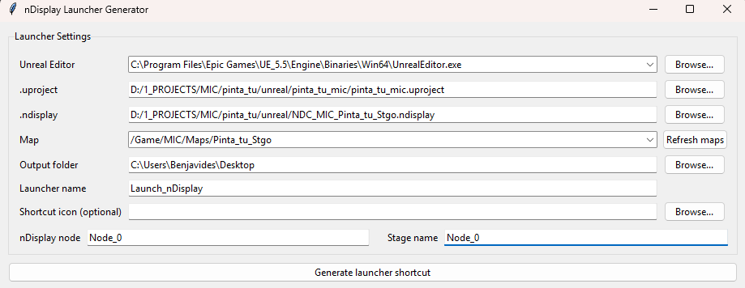

# nDisplay Launcher Generator

Simple Windows app that creates a shortcut (`.lnk`) to launch a specific Unreal project in nDisplay (cluster) mode.

Useful when you want the machine to start directly in nDisplay mode (for example at startup) without manual clicks.



## What it does

- Finds installed Unreal Editor versions automatically (`UE_*` in Epic Games folders).
- Lets you pick:
  - `.uproject`
  - `.ndisplay` config
  - map (`/Game/...`) found from project `Content/*.umap`
- Creates:
  - `<name>.ndisplay-launch.json` profile
  - `<name>.lnk` shortcut that starts Unreal in nDisplay mode with that profile

## Requirements

- Windows
- [uv](https://docs.astral.sh/uv/)
- Python 3.11+ (managed by `uv`)

## Run locally

```powershell
uv sync
uv run ndisplay-launcher-generator
```

## Build distributable EXE

```powershell
.\build_exe.ps1
```

Output:

- `dist\nDisplayLauncherGenerator.exe`

You can distribute this EXE directly.

## Generated launcher behavior

- The `.lnk` opens PowerShell and runs the launcher script stored inside the generated profile JSON.
- That script starts Unreal with the selected nDisplay config and map.
- Closing that PowerShell window stops the launched Unreal process.

## Notes

- Map list only populates after selecting a valid `.uproject`.
- If no Unreal install is auto-detected, use **Browse** next to Unreal Editor.
- Default node/stage names are `Node_0` and can be changed per launcher.
- To auto-launch on Windows startup, put the generated `.lnk` in:
  - `C:\Users\[username]\AppData\Roaming\Microsoft\Windows\Start Menu\Programs\Startup`

